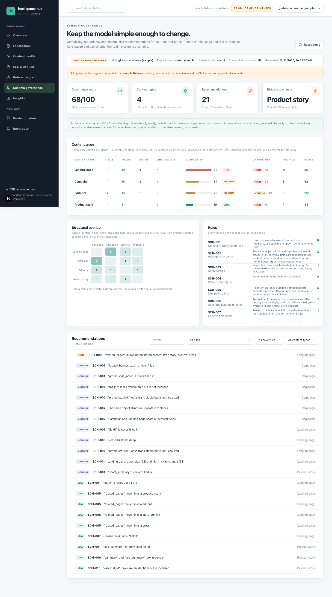

# Schema governance (`/schema`)

Complexity, redundancy and **change-risk** recommendations for your content types, computed from the schemas, **real field usage** across content items, and the **reference graph**. Everything is rule-based and explainable, and the tool never edits a schema.



## What goes in

All of it comes from the normal scan, with no extra API calls:

- **Schemas**: every registered content type, normalised from its JSON Schema (objects, arrays, content links with their allowed types, image/video links, localized values).
- **Field usage**: for each schema path, how many content items hold a master-locale value. Array items collapse to their schema path (`steps.title`), so you see usage per *definition*, not per instance. Empty strings and untouched booleans do not count as filled.
- **Inbound references**: from the [reference graph](reference-graph.md), used for change risk.

## Metrics

```
complexity = fields + 4×maxDepth + min(3×linkTargets, 30) + 2×objects + links     bands: low <25 ≤ medium <60 ≤ high
change risk = min(100, 1.5×items + 2×inboundItems + 8×inboundTypes)      bands: low <30 ≤ medium <60 ≤ high
type score  = max(0, 100 − Σ penalties)    high 15 · medium 8 · low 3          hub score = mean over types with fields
```

Depth counts inline objects as levels (`steps → title` is depth 2). Change risk answers "how much would a breaking change touch?": content items that carry the change, items elsewhere that link to this type, and (with several locales) the locales to re-check. A *breaking* change is removing, renaming or retyping a field, or changing localization settings.

## Rules

| Rule | Title | Severity | Detection logic |
|---|---|---|---|
| `SCH-001` | Unused or rarely used field | medium / low | Never populated across ≥5 content items (medium), or populated in under 10% of ≥10 items (low) |
| `SCH-002` | Repeated structure | medium | The same object of ≥3 fields appears in several places, or ≥3 identical fields are repeated across content types: a candidate for a shared schema definition (`$ref`) or its own content type |
| `SCH-003` | Deep nesting | medium / high | Inline objects nested 4+ levels (medium) or 5+ (high): hard to edit in the content form and heavy to deliver |
| `SCH-004` | Wide content type | low / medium | More than 25 fields (low) or 40 (medium) |
| `SCH-005` | Link palette bloat | medium / low | A content link (e.g. a page's component list) accepts more than 12 content types, or an allowed content type is never linked |
| `SCH-006` | Near-duplicate field names | low | Two fields of the same type whose names differ only by a seo/meta/og prefix (camelCase or snake_case), so editors must guess which to fill (title/metaTitle is exempt) |
| `SCH-007` | Generic field name | low | Field uid such as field1, new_field, untitled, test: unclear intent and brittle to integrate |
| `SCH-008` | Empty content type | low | No content items in the scanned repositories: candidate for retirement (or a template not yet used) |
| `SCH-009` | Broken or broad reference | high / low | Reference field points at a content type that does not exist (high), or at more than 5 types (low) |
| `SCH-010` | Localization setting looks wrong | medium / low | Translatable-looking text (headline, description, label…) is non-localizable (medium), or an identifier (sku, id, slug, code…) is localizable (low). `title` is exempt (often an internal name) |
| `SCH-011` | Fragile core type | medium | High complexity combined with high change risk: changes here are expensive and need a migration plan |

A flagged container suppresses its children: an unused or rarely used object produces **one** finding, not one per inner field. Thresholds are defaults in `lib/domain/schema-governance.ts` (`GOV`).

## The page

- **Content types** table: content items, fields, depth, link targets, complexity bar, change-risk band, findings and score. Click a row for the type drawer.
- **Structural overlap** heatmap: shared identical fields (same name and type, excluding `title` and the delivery key) between every pair of types. Click a cell to see exactly which fields are shared. High overlap is a Global Field or merge candidate.
- **Recommendations**: every finding with evidence and a concrete recommendation, filterable by rule, severity and type.
- **Type drawer**: the full field tree with a usage bar per field (red = never filled), localization status (*localized* / *same in all*), mandatory markers, and a "if you make a breaking change here" box.

## Try it

```bash
npm run dev            # /schema in demo or live mode
npm run live:schema    # read-only: scan the live hub, print the type table, counts per rule and one example each
```

## Limits and honest caveats

- Usage is measured on **master-locale** values only: a field filled solely in other locales looks unused. Confidence requires at least 5 content items per type (10 for "rarely used").
- Usage shows data, not **code**: a field nothing in the CMS fills may still be read by a front end. Treat "unused" as a prompt to check, not a delete list.
- Change risk is a transparent proxy from content items and links; it does not know about your deployments, integrations or workflows.
- Only the scanned repositories are analysed; `SCH-008` (empty type) may be a template, not waste.
- `SCH-010` is a heuristic over field *names*; multi-market sites often localize URLs on purpose, which is why identifier checks are low severity.
- The tool recommends; it does not generate migrations or modify content types.

---
[← Back to README](../README.md) · [All documentation](README.md)
